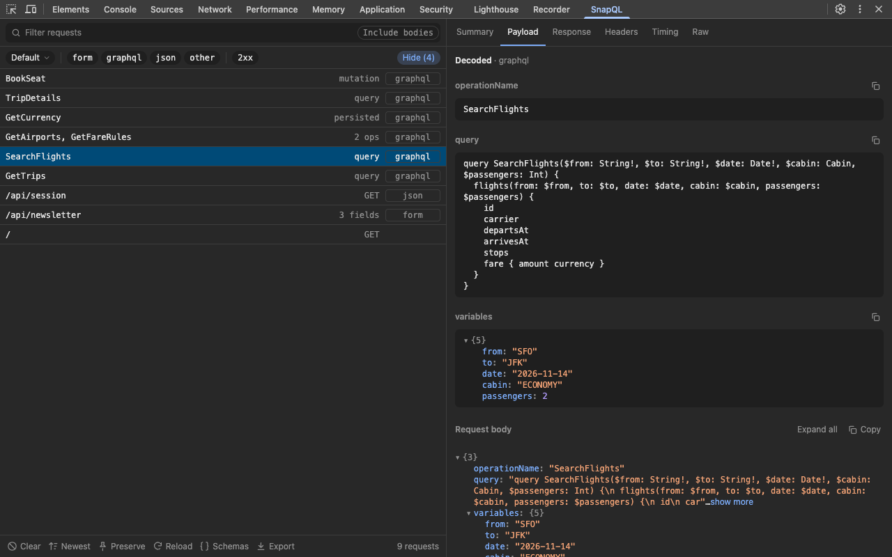
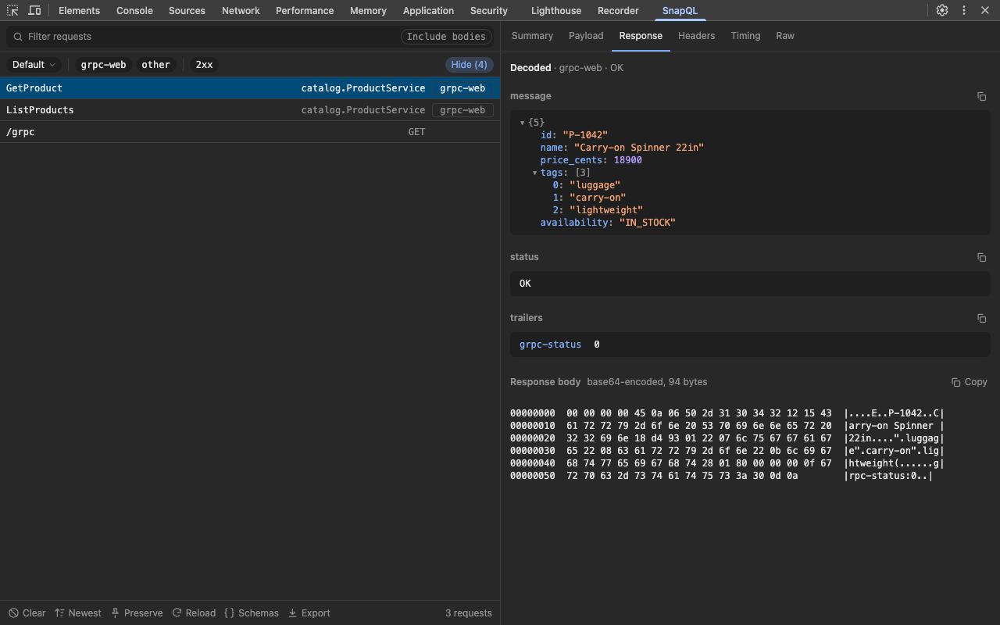
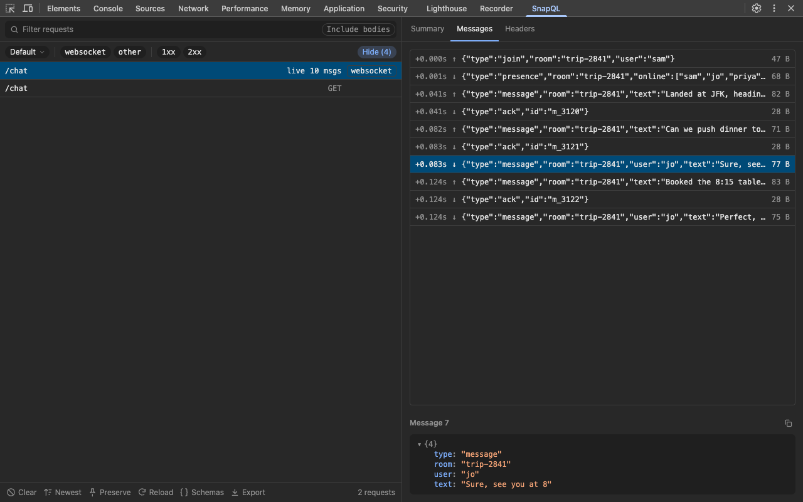
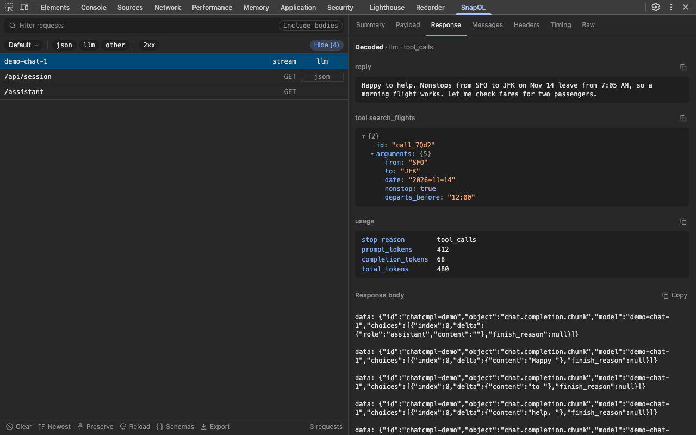
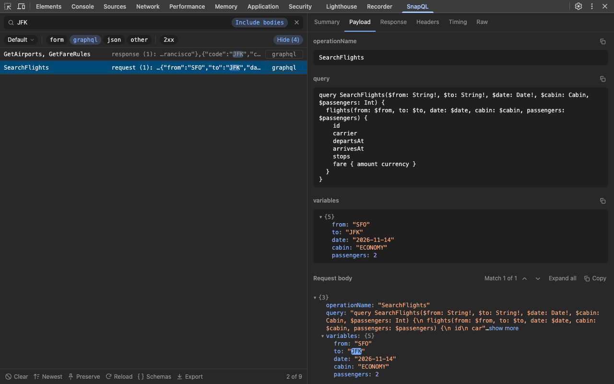

# SnapQL

Human-readable network traffic in DevTools: GraphQL, REST, gRPC-web, protobuf, WebSocket, SSE and LLM streams, decoded.

[](https://chrome.google.com/webstore/detail/bopfjlgmfhmpnceeknaddfgeanchkbmm)


SnapQL adds a tab to Chrome DevTools that lists the page's traffic by what it means: GraphQL operations by name, gRPC calls by method, WebSockets by their messages, LLM streams by their reassembled reply. Pick a request and read its payload and response decoded, instead of raw bytes and escaped JSON.



|                                                                                          |                                                                          |
| ---------------------------------------------------------------------------------------- | ------------------------------------------------------------------------ |
|                      |             |
| gRPC-web decoded with field names from your `.proto` files                               | WebSocket frames, each decoded on its own                                |
|  |  |
| LLM streams put back together: reply, tool calls, usage                                  | Search inside request and response bodies                                |

---

### What it decodes

- **GraphQL**: operation names and types, variables, batching, persisted queries, file uploads, `@defer` and error paths
- **REST and JSON**, form data and multipart uploads
- **XML and SOAP**, **JSON-RPC** and **tRPC**
- **gRPC-web and protobuf**, readable without a schema, with field names once you add your `.proto` files
- **MessagePack** and **CBOR**
- **WebSocket**, **Socket.IO** and **graphql-ws** messages
- **Server-sent events** and **NDJSON** streams
- **LLM streams** (OpenAI and Anthropic APIs): reply, thinking, tool calls and token usage
- **JWTs** in headers and cookies, images and fonts as previews

### Find the request you want

- Search request names, URLs and, optionally, bodies; jump between matches
- Filter by protocol and status
- Save filters as workspaces; hide preflights, cached responses, service worker copies and static assets
- Copy any request as cURL or fetch
- Export to HAR with tokens, cookies and passwords redacted
- Follows the DevTools light or dark theme

### Privacy

SnapQL needs no permissions and runs only while DevTools is open. It collects nothing and sends nothing anywhere.

---

### Install

[Install from the Chrome Web Store](https://chromewebstore.google.com/detail/bopfjlgmfhmpnceeknaddfgeanchkbmm), then open DevTools and pick the **SnapQL** tab.

Firefox builds work when loaded unpacked (below) but are not published yet.

### Development

Requires Node 22+ and pnpm 10+.

```sh
pnpm install
pnpm build        # dist/chrome and dist/firefox
```

Load the build:
- **Chrome:** open `chrome://extensions`, enable Developer mode, Load unpacked, pick `dist/chrome`
- **Firefox:** open `about:debugging#/runtime/this-firefox`, Load Temporary Add-on, pick `dist/firefox/manifest.json`

Checks:

```sh
pnpm lint         # Biome
pnpm typecheck
pnpm test         # unit tests
pnpm e2e          # the panel in headless Chromium DevTools
pnpm screenshots  # retakes the store screenshots in store/screenshots
```

Releasing is described in [docs/build.md](docs/build.md); how the pieces fit together starts at [docs/overview.md](docs/overview.md).

---

### Contributing

Contributions are welcome. If you have a format to support, a bug report or a fix, [open an issue](https://github.com/akshay-xp/snapql/issues) or submit a pull request.

---

### License

Licensed under the **GNU General Public License v3.0**.
See [LICENSE](LICENSE) for details.
